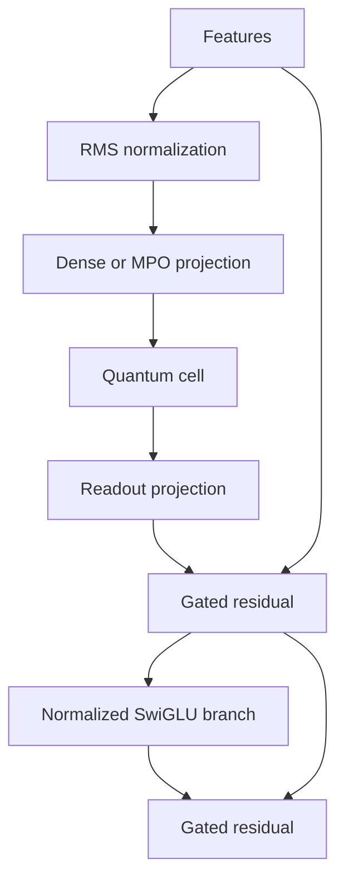

# Hybrid neural network architecture

`HybridArchitecture` is a framework-independent model program. It defines the
hybrid blocks, quantum cells, projection representations, parameter layout and
resource policy once. PyTorch, JAX and Flax execute the same program with the
same canonical parameter names. `QuantumDeepNetwork(...)` is a convenience
constructor for this architecture.

## Model composition

Each hybrid block has two pre-normalized, gated residual branches:

A stem maps input features to a fixed hidden width; the final readout maps that
width to logits or task features. Leading batch/token dimensions are preserved.
`projection_policy="auto"` chooses an MPO when it uses fewer parameters than a
dense map. `bond_dimension` controls MPO capacity; `"dense"` and `"tensor-train"`
pin a representation. Fewer parameters do not guarantee lower GPU latency.

`QuantumCellSpec` selects a multiscale unitary cell or a quantum residual-channel
cell. Pass one specification for every block, or a tuple with one per block.
Hybrid blocks exchange classical feature tensors. A residual-channel cell keeps
its quantum data register across its internal sublayers and implements
`rho_next = (1-p) rho + p U rho U†`, with `p = sin(alpha/2)²`. Controlled
RY/RZ/RZZ gates and one resettable ancilla implement this channel without
postselection. Multiscale cells use disentanglers and configurable retained spaces.

`HybridArchitecture.depth` is allocated hybrid depth. `QuantumCellSpec.depth`
is quantum depth within a cell. These are independent capacity controls.
`resource_profile()` reports parameters, projection choices, quantum circuits
and storage estimates before training; `max_parameters` and `max_memory_mb`
control admission without imposing a fixed qubit ceiling.

## Parameters and progressive training

All blocks have their parameters allocated before optimizer construction.
`active_depth` changes execution, not ownership or parameter shapes. Gates start
at zero, so activating a previously frozen block initially preserves the model
function. Gates receive gradients first; quantum branch weights begin learning
once the gates open. This is an initialization strategy, not a general absence
of barren plateaus.

`DepthSchedule(((0, 1), (100, 2), (200, 4)))` activates one, two and four blocks
at those counts of successful optimizer updates. Skipped nonfinite updates do
not advance the curriculum. Inactive Torch parameters retain `grad=None` and
are untouched by AdamW. JAX/Flax use `StagewiseOptimizer`: inactive blocks keep
both parameters and optimizer moments/counters unchanged, including weight decay.
Growing depth preserves old optimizer state and does not replace parameters.

| Framework | Build and ownership | Training |
| --- | --- | --- |
| PyTorch | `architecture.build("torch")`; one `ParameterDict` | `model.trainer(...)`, then `step(batch, loss(model, batch))` |
| JAX | `architecture.build("jax")`; `init(key)` returns a flat PyTree | `model.trainer(optimizer, loss(model, params, batch), key=...)`, then `step(batch)` |
| Flax | `architecture.build("flax")`; Linen `init`/`apply` with the same parameter names | `module.trainer(..., variables=...)`; trained parameters remain usable in `module.apply(trainer.variables, inputs)` |

Torch accepts a scalar mean or per-example loss; JAX/Flax training losses return
one value per example. Microbatches accumulate into one optimizer update.
Quantum and classical gradient norms are reported separately before clipping.
Torch supplies role-based optimizer groups, including a separate quantum
learning rate and no automatic angle decay. Other optimizers can be supplied;
Optax transforms with callable parameter labels work with the stagewise groups.

`model.make_train_step(...)` provides pure JIT-compatible JAX/Flax updates for
callers managing their own distributed loop. Compile a new update function at
a curriculum boundary and retain the existing parameter/optimizer trees.
Torch DDP supports progressive training with `find_unused_parameters=True` and
`static_graph=False`. The existing global sample weighting handles unequal
local batch sizes.

`trainer.save(path)` stores the architecture identity, active depth, curriculum,
parameters, optimizer state and update counters. Torch also saves its RNG state;
JAX/Flax use an atomic, pickle-free NPZ checkpoint and validate the initialized
optimizer tree. Recreate the same optimizer transform when loading. Dataset
position and stochastic state owned by a custom loss/data loader remain caller-owned.

## Execution and optimization

`architecture.schedule(scheduler=..., workload=...)` plans the entire active
network. It combines per-cell nondominated hardware choices under shared cost,
latency and readout-error constraints; it can select different devices for
different blocks. A bounded Pareto search prevents exponential planning growth.
The forecast counts controlled-gate shift recipes, measurement groups, sequential
microbatch forward/backward phases, client chunk sizes and declared classical work.

The integrated trainers replan at update boundaries. Execution stays pinned
through every primal/pullback pair. Changing a route replaces a parameter-free
execution view; it preserves model parameters and optimizer state. Native
Torch transfers remain differentiable. JAX retains its native platform inside
a JIT graph and uses an explicit first-order numeric bridge for other devices.
Quote sources should identify calibration revisions without changing for every
telemetry poll; unchanged routes reuse compiled execution views.
With a `BudgetLedger`, integrated trainers reserve the native and declared
classical cost before an update; QPU calls reserve their refreshed quotes at
submission. Failed updates retain reservations. Direct model calls and custom
training loops own their native accounting. These are forecast reservations,
not reconciled cloud invoices.

Block rematerialization reduces native activation storage. It is disabled for
external QPU calls so backward does not resubmit stochastic jobs. A Torch
`tensor_mesh` and calibrated `interconnect` connect admitted unitary cells to
`DistributedTensorPlan`; mixed-state cells remain local. Tensor ranks share
canonical parameters and use separate data-parallel groups. Tensor-parallel
checkpoints use one file per global rank and require the matching topology.
A pinned tensor mesh uses caller-owned distributed accounting. Automatic
single-device budget/deadline profiles are rejected for this mode.

Exact circuit/mixed-state cost can still grow exponentially with entangled
width. A shallow retained space or low MPO bond rank constrains expressivity.
The architecture makes those choices explicit; it does not establish quantum
advantage, large-cluster speedup or universal trainability.

The gated identity initialization follows [ReZero](https://arxiv.org/abs/2003.04887).
Quantum residual channels draw on [postselection-free quantum residual networks,
2026](https://arxiv.org/abs/2604.06866); standalone `DeepQuantumPlan.grow` uses the
identity-embedding principle studied in [progressive depth training,
2026](https://arxiv.org/abs/2607.16800). These research results are not performance
guarantees for every architecture built with the library.
